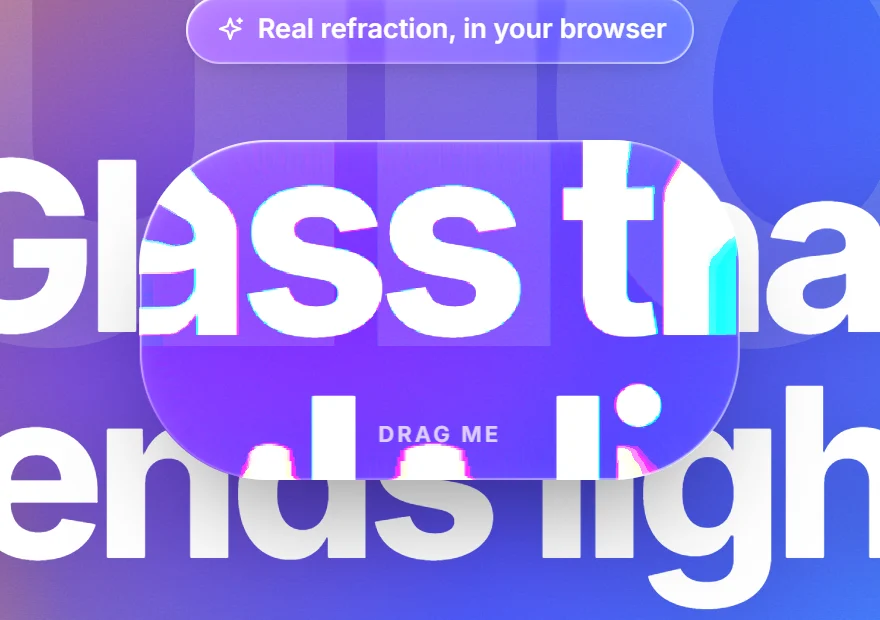

# vitre

**Liquid glass for the web.** UI components that refract what is behind them through a curved rim, split it into colors at the edges, catch the light where your pointer is, and stretch like a drop when you press them.

[](https://www.npmjs.com/package/vitre)
[](#size)
[](LICENSE)

|  |  |
| :--: | :--: |
| A card, frosted, with a refracting rim | A loupe: a narrow rim and a magnified middle |


Not a blur. Each pane is a slab of glass: each pixel of its rim is traced through it with Snell's law, so the backdrop bends around the edges like a shop window, with red, green and blue each bending their own way.

- **Real refraction**, from a physical model of the rim: no mirrored copies, no seams at the corners.
- **Color fringes** along the rim, where the glass is steepest.
- **Light that follows you**: the rim lights up on the side facing the pointer (or with the tilt of the phone, where the browser allows it), and a soft glare follows it.
- **Liquid touch**: buttons swell, glow where you touch them, stretch towards your finger and spring back. Selections are glass drops that slide, stretch with their speed, and turn into a magnifying lens when you grab them.
- **Everything an interface needs**: buttons, icon buttons, chips, cards, tiles, text fields, switches, sliders, segmented controls, tab bars, toolbars, menus, toasts and sheets.
- **Plain HTML and CSS classes**: works with any framework, or none. Accessible roles, keyboard support, `prefers-reduced-motion`, `prefers-reduced-transparency` and forced colors.
- **Graceful**: without the script, or in browsers that can't refract, it is frosted glass with the same rim, light and shadows.

## Install

```sh
npm i vitre
```

```js
import { vitre } from 'vitre';
import 'vitre/style.css';

vitre();
```

Or with a `<script>` tag, which starts on its own:

```html
<link rel="stylesheet" href="https://cdn.jsdelivr.net/npm/vitre/dist/vitre.css" />
<script src="https://cdn.jsdelivr.net/npm/vitre/dist/vitre.iife.js"></script>
```

## Components

`.vitre` is the material; `.vitre-*` classes shape it. Glass needs something to bend: put it over a photo, a gradient, text, a video, a canvas.

```html
<!-- buttons -->
<button class="vitre vitre-button">Save</button>
<button class="vitre vitre-button vitre-button--tinted">Share</button>
<button class="vitre vitre-button vitre-button--solid">Done</button>
<button class="vitre vitre-icon" aria-label="Play">…svg…</button>
<button class="vitre vitre-chip" aria-pressed="true">Photos</button>

<!-- a card, with etched tiles inside -->
<article class="vitre vitre-card">
  <div class="vitre-tile"><span class="vitre-stat">148</span><span class="vitre-label">Projects</span></div>
</article>

<!-- a text field -->
<label class="vitre vitre-field">…svg… <input type="search" placeholder="Search" /></label>

<!-- a segmented control: click, arrow keys, or drag the drop -->
<div class="vitre vitre-segmented" role="radiogroup" aria-label="Range">
  <button role="radio" aria-checked="true">Day</button>
  <button role="radio" aria-checked="false">Week</button>
</div>

<!-- a tab bar -->
<nav class="vitre vitre-tabbar" role="tablist">
  <button role="tab" aria-selected="true">…svg… Home</button>
  <button role="tab" aria-selected="false">…svg… Search</button>
</nav>

<!-- a toolbar and a menu: a drop glides under the hovered item -->
<div class="vitre vitre-toolbar" role="toolbar"><button aria-label="Edit">…</button><hr /><button aria-label="Delete">…</button></div>
<div class="vitre vitre-menu" role="menu"><button role="menuitem">Copy</button><hr /><button role="menuitem">Delete</button></div>

<!-- a switch and a slider: their thumbs turn into lenses while you hold them -->
<label class="vitre-switch"><input type="checkbox" /> Wi-Fi</label>
<div class="vitre-slider"><input type="range" aria-label="Volume" /></div>

<!-- a sheet, on a native dialog -->
<dialog class="vitre vitre-sheet">…</dialog>
```

Segmented controls and tab bars fire a `vitre:change` event (`detail: { index, value }`, `value` from `data-value` or the label). Switches and sliders are real inputs: forms, `change` events and the keyboard work as usual.

```js
import { toast } from 'vitre';

toast('Saved'); // a glass pill drops in from the top
```

Tints: `vitre--clear`, `vitre--frosted`, `vitre--dark`, `vitre--light`, `vitre--tinted`. Sizes: `vitre-button--sm`, `--lg`, `--block`.

## Tuning the glass

Every setting is a CSS custom property: set it on `:root` for the page, on a section, or on one element. The script reads them.

| Property | Default | |
| --- | --- | --- |
| `--vitre-refraction` | `1` | How strongly the rim bends, `0` for flat glass |
| `--vitre-bezel` | per component | Width of the rounded rim, px (unitless) |
| `--vitre-thickness` | `bezel × 0.5` | How far bent rays land, px |
| `--vitre-ior` | `1.5` | Index of refraction |
| `--vitre-dispersion` | `0.5` | Color fringes, `0` to `1` |
| `--vitre-blur` | per component | Frosting, px |
| `--vitre-frost` | `0` | Extra frosting for every pane, px |
| `--vitre-saturation` | `1.7` | |
| `--vitre-brightness` | `1.05` | |
| `--vitre-magnify` | `1` | Magnifies the whole pane: a loupe |
| `--vitre-tint` | translucent white | The glass color |
| `--vitre-accent` | `#0a84ff` | Tinted buttons, sliders, focus rings |
| `--vitre-on` | `#34c759` | Switches when on |
| `--vitre-shadow` | soft | The shadow under each pane |
| `--vitre-spring` | a bouncy spring | Easing of touch (a CSS `linear()` curve) |

After changing them from JavaScript, call `refresh()`.

## API

```ts
const glass = vitre({
  root: document,   // where to look for glass; elements added later are picked up
  refraction: true, // false: frosted glass everywhere
  light: true,      // highlights face the pointer
});

glass.refraction;   // whether this browser really refracts
glass.refresh(el?); // re-read sizes and --vitre-* settings
glass.destroy();

toast(message, { duration, icon }); // returns a function that dismisses it
canRefract();                       // can this browser refract?
lensMap(shape);                     // the displacement map itself, for your own SVG filters or WebGL
```

## How it works

1. **The lens.** For each pane, a displacement map is computed on a canvas: the distance of every pixel to the rounded edge gives its place on the rim, a squircle-like profile gives the slope of the glass there, and Snell's law gives how far a ray bends over the glass thickness. The mapping is kept monotonic, so the view never folds back into mirrored copies, and the bending turns gradually around corners.
2. **The filter.** The map feeds an SVG filter used as `backdrop-filter: url(#…)`: frosting, then three `feDisplacementMap` passes with slightly different strengths, one per color channel, blended back together for the fringes, then saturation. Panes of the same size and settings share one filter.
3. **The light.** The script tracks the pointer and gives every visible pane a light direction and a glare position as CSS variables; the stylesheet turns them into the specular rim, the bevel and the glare.
4. **The touch.** Presses, pulls and drags are springs: CSS `linear()` easings for releases, a small physics step for the sliding drops, which stretch with their speed.

## Browser support

Real refraction needs SVG filters in `backdrop-filter`, which only Chromium renders: Chrome, Edge, Opera, Brave, Arc, Samsung Internet. Safari and Firefox get frosted glass (blur and saturation) with the same rim, light, shadows and interactions. Without JavaScript, everything is styled and usable; the switches and sliders are native inputs.

Glass inside glass doesn't refract the page (a browser rule for nested backdrop filters, and Apple's guidance too): that's what `vitre-tile` is for inside cards. The drops of segmented controls and tab bars do bend what is under them: the labels.

## Size

About 7 kB of JavaScript and 4 kB of CSS, gzipped. No dependencies.

## Pairs well with

[deep-sky](https://github.com/RaphaelPelerin/deep-sky), a living cosmic background: glass panes over it bend the nebula and the stars.

## Development

```sh
npm install
npm run dev        # the demo, with live reload
npm test           # the lens math
npm run build      # dist/
node scripts/capture.mjs   # README images, from the built demo (npm run build:demo)
```

## License

MIT © 2026 Raphael Pellerin
