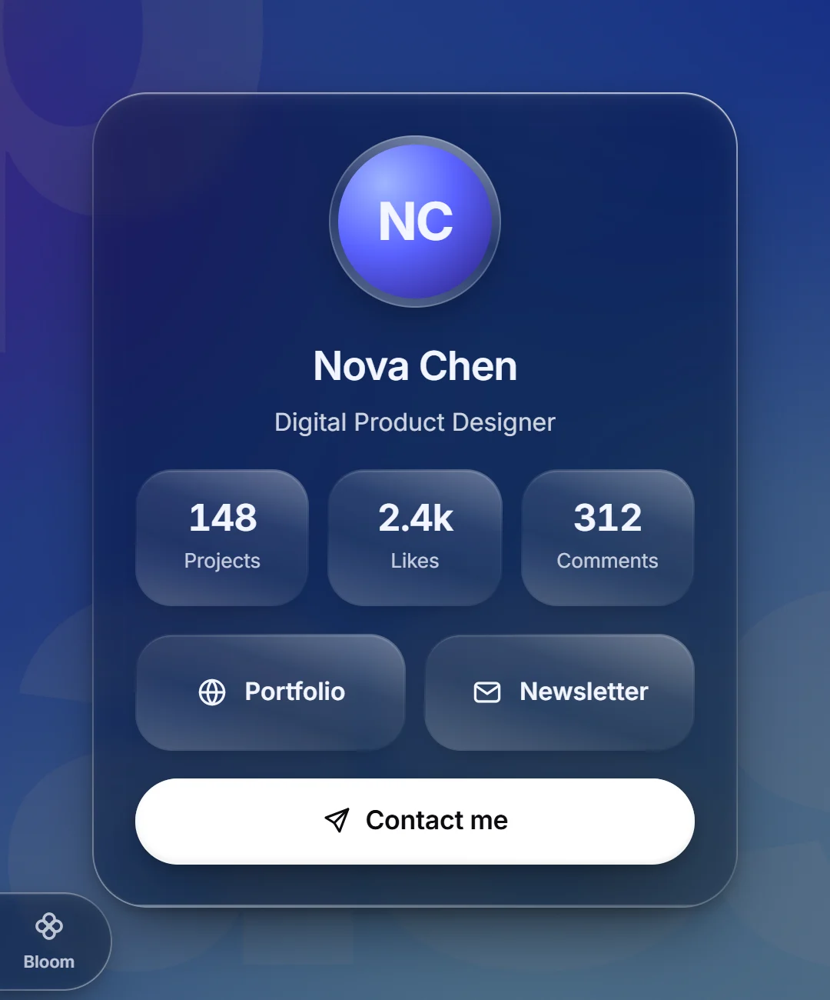
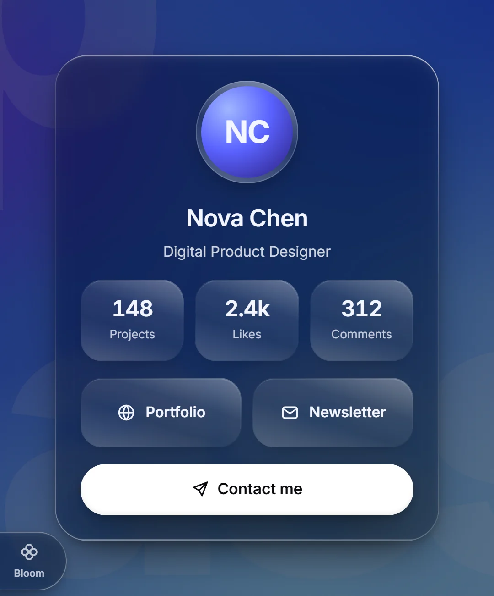
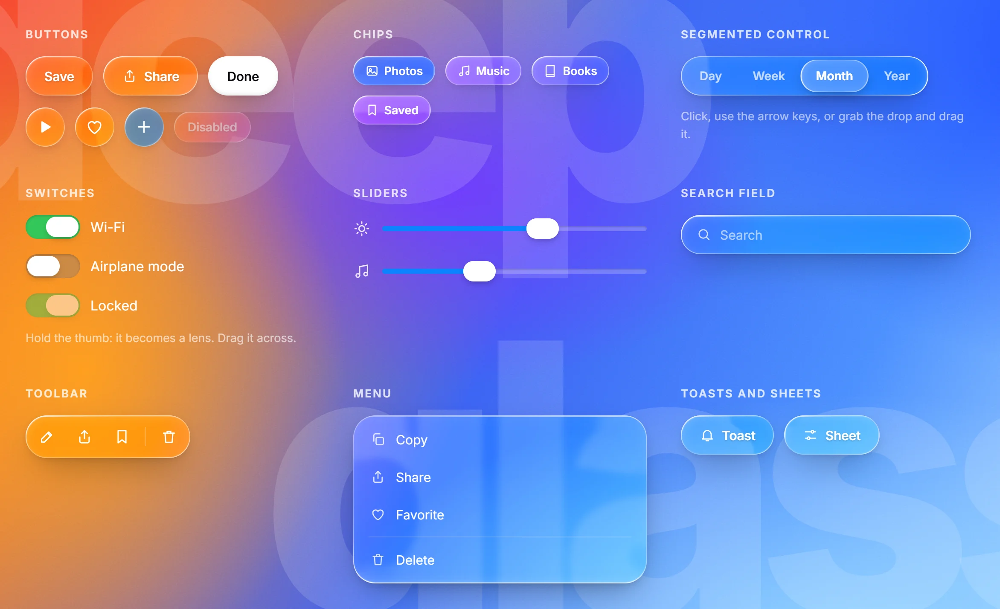

# deep-glass

**Deep glass for the web.** UI components that refract what is behind them through a curved rim, split it into colors at the edges, catch the light where your pointer is, and stretch like a drop when you press them.

[](https://www.npmjs.com/package/deep-glass)
[](#size)
[](LICENSE)

**[Live demo →](https://deep-glass.vercel.app)** Drag the loupe, press the buttons, switch to dark glass.

|  |  |  |
| :--: | :--: | :--: |
| A card, frosted, with a refracting rim | The same card in [dark glass](#dark-glass) | A loupe: a narrow rim and a magnified middle |



Not a blur. Each pane is a slab of glass: each pixel of its rim is traced through it with Snell's law, so the backdrop bends around the edges like a shop window, with red, green and blue each bending their own way.

- **Real refraction**, from a physical model of the rim: no mirrored copies, no seams at the corners.
- **Color fringes** along the rim, where the glass is steepest.
- **Light that follows you**: the rim lights up on the side facing the pointer (or with the tilt of the phone, where the browser allows it), and a soft glare follows it.
- **Springy touch**: buttons swell, glow where you touch them, stretch towards your finger and spring back. Selections are glass drops that slide, stretch with their speed, and turn into a magnifying lens when you grab them.
- **Everything an interface needs**: buttons, icon buttons, chips, cards, tiles, text fields, switches, sliders, segmented controls, tab bars, toolbars, menus, toasts and sheets.
- **Plain HTML and CSS classes**: works with any framework, or none. Accessible roles, keyboard support, `prefers-reduced-motion`, `prefers-reduced-transparency` and forced colors.
- **Graceful**: without the script, or in browsers that can't refract, it is frosted glass with the same rim, light and shadows.

## Install

```sh
npm i deep-glass
```

```js
import { deepGlass } from 'deep-glass';
import 'deep-glass/style.css';

deepGlass();
```

Or with a `<script>` tag, which starts on its own:

```html
<link rel="stylesheet" href="https://cdn.jsdelivr.net/npm/deep-glass/dist/deep-glass.css" />
<script src="https://cdn.jsdelivr.net/npm/deep-glass/dist/deep-glass.iife.js"></script>
```

## Components

`.dg` is the material; `.dg-*` classes shape it. Glass needs something to bend: put it over a photo, a gradient, text, a video, a canvas.

```html
<!-- buttons -->
<button class="dg dg-button">Save</button>
<button class="dg dg-button dg-button--tinted">Share</button>
<button class="dg dg-button dg-button--solid">Done</button>
<button class="dg dg-icon" aria-label="Play">…svg…</button>
<button class="dg dg-chip" aria-pressed="true">Photos</button>

<!-- a card, with etched tiles inside -->
<article class="dg dg-card">
  <div class="dg-tile"><span class="dg-stat">148</span><span class="dg-label">Projects</span></div>
</article>

<!-- a text field -->
<label class="dg dg-field">…svg… <input type="search" placeholder="Search" /></label>

<!-- a segmented control: click, arrow keys, or drag the drop -->
<div class="dg dg-segmented" role="radiogroup" aria-label="Range">
  <button role="radio" aria-checked="true">Day</button>
  <button role="radio" aria-checked="false">Week</button>
</div>

<!-- a tab bar -->
<nav class="dg dg-tabbar" role="tablist">
  <button role="tab" aria-selected="true">…svg… Home</button>
  <button role="tab" aria-selected="false">…svg… Search</button>
</nav>

<!-- a toolbar and a menu: a drop glides under the hovered item -->
<div class="dg dg-toolbar" role="toolbar"><button aria-label="Edit">…</button><hr /><button aria-label="Delete">…</button></div>
<div class="dg dg-menu" role="menu"><button role="menuitem">Copy</button><hr /><button role="menuitem">Delete</button></div>

<!-- a dropdown: a menu with `popover`, and a button that points to it -->
<button class="dg dg-button" popovertarget="actions">Actions <span class="dg-chevron"></span></button>
<div class="dg dg-menu" popover role="menu" id="actions">
  <button role="menuitem">Rename<kbd>F2</kbd></button>
  <button role="menuitemcheckbox" aria-checked="true">Sidebar</button>
  <hr />
  <button role="menuitem" data-danger>Delete</button>
</div>

<!-- a select: the native one keeps the value -->
<div class="dg dg-select"><select aria-label="City"><option>Paris</option><option>Tokyo</option></select></div>

<!-- a switch and a slider: their thumbs turn into lenses while you hold them -->
<label class="dg-switch"><input type="checkbox" /> Wi-Fi</label>
<div class="dg-slider"><input type="range" aria-label="Volume" /></div>

<!-- a sheet, on a native dialog -->
<dialog class="dg dg-sheet">…</dialog>
```

Dropdowns use the browser's popovers: they close on Escape or a click outside, and lie above everything. The script places them by their button (`data-align="start"`, `center` or `end`; above it when there is no room), handles the keyboard, and ticks `menuitemcheckbox` and `menuitemradio` items, with a `dg:change` event (`detail: { value, checked }`). `data-dg-keep` on an item or the menu keeps it open after a click. Wrap a long list of items in `<div class="dg-menu__scroll">`. A row with its own `popovertarget` opens a submenu, as deep as you like: on hover, on click or with the right arrow, beside its parent (over it when the screen is too narrow). Picking an item closes the whole chain.

A `dg-select` needs no code of its own: its `<select>` fires `input` and `change` as usual, and stays native where popovers are missing.

Segmented controls and tab bars fire a `dg:change` event (`detail: { index, value }`, `value` from `data-value` or the label). Switches and sliders are real inputs: forms, `change` events and the keyboard work as usual.

```js
import { toast } from 'deep-glass';

toast('Saved'); // a glass pill drops in from the top
```

Tints: `dg--clear`, `dg--frosted`, `dg--dark`, `dg--light`, `dg--tinted`. Sizes: `dg-button--sm`, `--lg`, `--block`.

## Dark glass

Smoked glass for dark interfaces: a darker tint, a dimmer backdrop, softer highlights, deeper shadows. Every component follows: tiles, drops, switch and slider tracks, separators, the scrim behind sheets.

```html
<html data-dg-theme="dark">      <!-- the whole page -->
<html data-dg-theme="auto">      <!-- follows the system's light or dark mode -->
<section data-dg-theme="dark">   <!-- one part of the page -->
<div data-dg-theme="light">      <!-- clear glass again, inside a dark part -->
<button class="dg dg-button dg--dark">Save</button>   <!-- a single pane -->
```

Switching the attribute is enough: the script sees it, or the system's change in `auto`, and remakes every lens with the dark optics. Panes switched with the `dg--dark` class need `refresh()`.

Each tone is a set of custom properties you can override: `--dg-tint`, `--dg-text`, `--dg-shadow`, `--dg-saturation`, `--dg-brightness`, and `--dg-tone-frosted`, `--dg-tone-strong` (drops), `--dg-tone-tile`, `--dg-tone-track`, `--dg-tone-rail`, `--dg-tone-line`, `--dg-tone-rim` (highlight strength), `--dg-tone-glare`, `--dg-tone-scrim`.

## Tuning the glass

Every setting is a CSS custom property: set it on `:root` for the page, on a section, or on one element. The script reads them.

| Property | Default | |
| --- | --- | --- |
| `--dg-refraction` | `1` | How strongly the rim bends, `0` for flat glass |
| `--dg-bezel` | per component | Width of the rounded rim, px (unitless) |
| `--dg-thickness` | `bezel × 0.5` | How far bent rays land, px |
| `--dg-ior` | `1.5` | Index of refraction |
| `--dg-dispersion` | `0.5` | Color fringes, `0` to `1` |
| `--dg-blur` | per component | Frosting, px |
| `--dg-frost` | `0` | Extra frosting for every pane, px |
| `--dg-saturation` | `1.7` (dark: `1.45`) | |
| `--dg-brightness` | `1.05` (dark: `0.84`) | |
| `--dg-magnify` | `1` | Magnifies the whole pane: a loupe |
| `--dg-tint` | translucent white (dark: smoke) | The glass color |
| `--dg-accent` | `#0a84ff` | Tinted buttons, sliders, focus rings |
| `--dg-on` | `#34c759` | Switches when on |
| `--dg-shadow` | soft | The shadow under each pane |
| `--dg-spring` | a bouncy spring | Easing of touch (a CSS `linear()` curve) |

After changing them from JavaScript, call `refresh()`.

## API

```ts
const glass = deepGlass({
  root: document,   // where to look for glass; elements added later are picked up
  refraction: true, // false: frosted glass everywhere
  light: true,      // highlights face the pointer
  adaptive: true,   // lighter effects when the page drops under 45 frames a second
});

glass.refraction;   // whether this browser really refracts
glass.refresh(el?); // re-read sizes and --dg-* settings
glass.destroy();

toast(message, { duration, icon }); // returns a function that dismisses it
canRefract();                       // can this browser refract?
lensMap(shape);                     // the displacement map itself, for your own SVG filters or WebGL
```

## How it works

1. **The lens.** For each pane, a displacement map is computed on a canvas: the distance of every pixel to the rounded edge gives its place on the rim, a squircle-like profile gives the slope of the glass there, and Snell's law gives how far a ray bends over the glass thickness. The mapping is kept monotonic, so the view never folds back into mirrored copies, and the bending turns gradually around corners.
2. **The filter.** The map feeds an SVG filter used as `backdrop-filter: url(#…)`: frosting, then three `feDisplacementMap` passes with slightly different strengths, one per color channel, blended back together for the fringes, then saturation. Panes of the same size and settings share one filter.
3. **The light.** The script tracks the pointer and gives every visible pane a light direction and a glare position as CSS variables; the stylesheet turns them into the specular rim, the bevel and the glare.
4. **The touch.** Presses, pulls and drags are springs: CSS `linear()` easings for releases, a small physics step for the sliding drops, which stretch with their speed.

## Browser support

Real refraction needs SVG filters in `backdrop-filter`, which only Chromium renders: Chrome, Edge, Opera, Brave, Arc, Samsung Internet. Safari and Firefox get frosted glass (blur and saturation) with the same rim, light, shadows and interactions. Without JavaScript, everything is styled and usable; the switches and sliders are native inputs.

Glass inside glass doesn't refract the page (a browser rule for nested backdrop filters): that's what `dg-tile` is for inside cards. The drops of segmented controls and tab bars do bend what is under them: the labels.

## Performance

Glass is drawn by the GPU on every frame where it or what's behind it moves, so deep-glass keeps that work small:

- **Tiny lens maps.** The browser redraws each displacement map on every frame, at a cost that grows with its size. The bending is smooth, so maps hold only about 8 pixels across the rim and the GPU stretches them: a button's map is about 1,600 pixels, and a 420×530 card's is 12,000 instead of 117,000. Across the demo page that's 6 times fewer pixels to redraw on every frame.
- **Fringes only where they show.** Color fringes take three passes instead of one, so they run only where they spread wider than a pixel, on clear glass.
- **Light only where you are.** The pointer lights at most four panes, the nearest, and turns the rim of two. The glare is drawn once, then only moved and faded by the GPU, and the bevel's shadows never change. Every box is read before anything is written.
- **Lighter where it has to be.** When the page stays under 45 frames a second while the light moves, effects go one step at a time: color fringes, then the light of the neighbors, then the refraction of small panes. They come back when there is room again. `adaptive: false` turns this off, `glass.quality` (0 to 3) tells the step.
- **Nothing for what you can't see.** A pane gets its lens only when it comes within a screen of the viewport: a long page starts with the few lenses at the top. Resting switch and slider thumbs are opaque, so they get no lens until you hold them, and hidden drops aren't drawn. Maps are encoded off the main thread, and new lenses are built a few per frame.

On the demo page, 28 refracting panes scroll at about 80% of the frame rate of the same page with no glass at all.

## Size

About 8 kB of JavaScript and 4 kB of CSS, gzipped. No dependencies.

## Pairs well with

[deep-sky](https://github.com/RaphaelPelerin/deep-sky), a living cosmic background: glass panes over it bend the nebula and the stars.

## Development

```sh
npm install
npm run dev        # the demo, with live reload
npm test           # the lens math
npm run build      # dist/
node scripts/capture.mjs   # README images, from the built demo (npm run build:demo)
```

## License

MIT © 2026 Raphael Pellerin
